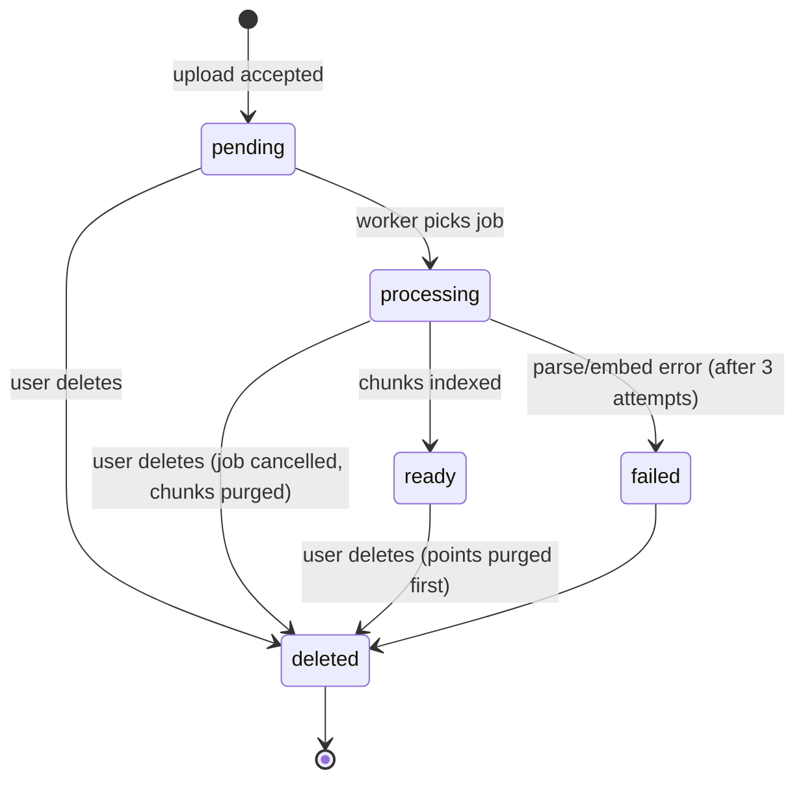
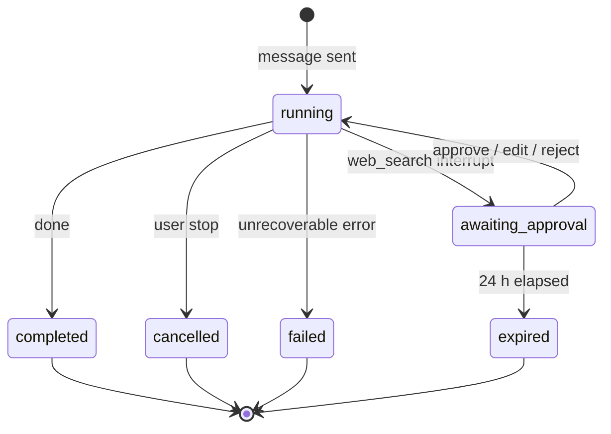
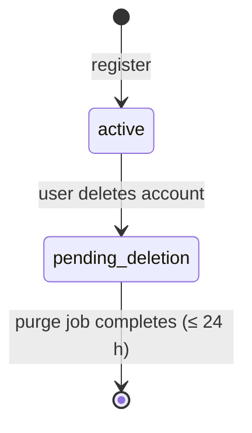

# Functional Specification — Nexus AI

**Version:** 1.0 · **Date:** 2026-11-19 · **PRD:** [`01_prd.md`](01_prd.md) · **API:** [`04_api_spec.yaml`](04_api_spec.yaml)

## 1. Overview

This document specifies user-visible behaviour of Nexus AI v1: flows, screens, per-feature behaviour, state machines, permissions and data retention. Requirement IDs (FR-xxx) refer to the PRD. Endpoint names refer to the OpenAPI spec, which is authoritative for request/response shapes.

## 2. User Flows

**UF-001 Register & first chat**
1. User opens `/register`, enters email, password, display name.
2. On success they land on `/` (new chat) with an empty-state screen showing example prompts.
3. User types a message and presses Enter → a conversation is created and the URL becomes `/c/{id}`.
4. Answer streams; after completion the sidebar shows the auto-generated title.

**UF-002 Continue a conversation**
1. User clicks a conversation in the sidebar → `/c/{id}` loads the message history (latest 50, older on scroll-up).
2. User sends a message; the answer streams below.

**UF-003 Stop & regenerate**
1. While streaming, the Send button becomes Stop. Clicking it cancels the run; the partial answer stays with a "Stopped" label.
2. On the last assistant message, the user clicks Regenerate → the message is replaced by a new streamed answer.

**UF-004 Upload a file and ask about it**
1. User clicks the paperclip in the composer (or goes to `/files`) and selects a file.
2. A chip shows upload progress, then `Processing…`, then `Ready` (polling every 2 s while not final).
3. User asks "What does the Q3 report say about churn?" → the assistant calls `search_my_files`; a tool card shows "Searching your files".
4. Answer streams with citation chips `[1] q3-report.pdf p.4`; clicking a chip shows the snippet in a popover.

**UF-005 Approve a web search**
1. User asks about current events → the stream emits an `interrupt`; an approval card shows the proposed query with Approve / Edit / Reject.
2. Approve → run resumes, the tool card shows results count, the answer streams with web citations.
3. Edit → user changes the query, then Approve. Reject → the assistant answers without searching and says so.
4. If the user reloads, the pending approval card is restored from the conversation state.

**UF-006 Memory**
1. User says "I mostly write Go and prefer concise answers."
2. After the turn, a subtle toast says "Memory updated" with a link to Settings → Memory.
3. In a new conversation the assistant answers in a concise style and assumes Go.
4. In Settings → Memory, user edits or deletes the memory, or turns memory off.

**UF-007 Feedback**
1. User hovers an assistant message, clicks 👍 or 👎; 👎 opens an optional comment box.

**UF-008 Delete account**
1. Settings → Account → Delete account → confirm by typing email → user is logged out; data is erased within 24 h.

## 3. Screen / Page Inventory

| Route | Purpose | Key UI elements | Auth |
|-------|---------|-----------------|------|
| `/login` | Sign in | Email, password, submit, link to register, error banner | Public (redirect to `/` if logged in) |
| `/register` | Create account | Email, display name, password + strength hint, submit | Public |
| `/` | New chat | Sidebar (conversations, New chat, Files, Settings, usage meter), empty state with example prompts, composer | Authenticated |
| `/c/:conversationId` | Conversation | Sidebar, message list (markdown, code blocks, tool cards, citation chips, approval cards, feedback buttons), composer (attach, send/stop), regenerate on last answer | Authenticated (owner only) |
| `/files` | Manage files | Upload dropzone, table (name, size, status, chunks, uploaded at, delete), limits indicator (n/50) | Authenticated |
| `/settings/account` | Profile & account | Display name, email (read-only), change password, export data, delete account | Authenticated |
| `/settings/memory` | Memory control | Toggle memory on/off, list memories (edit inline, delete), Clear all | Authenticated |
| `/settings/usage` | Usage | Tokens used today vs. budget, messages today | Authenticated |
| `/settings/appearance` | Theme | Light / Dark / System | Authenticated |
| `*` | 404 | Message + link home | Public |

## 4. Feature Specifications

### FS-001 Authentication (FR-001…005)
- **Trigger:** `/register`, `/login`; token refresh happens silently when an API call returns 401 with `token_expired`.
- **Happy path:** register → logged in; access token kept in memory only; refresh cookie set by API.
- **Validation:** email RFC 5322 and ≤ 254 chars, lower-cased; password 10–128 chars, not in common-password list; display name 1–60 chars.
- **Errors:** `EMAIL_TAKEN` "An account with this email already exists."; `INVALID_CREDENTIALS` "Email or password is incorrect." (no user enumeration); `RATE_LIMITED` after 10 failed logins / 15 min per IP+email.
- **Edge cases:** refresh token reuse → all sessions revoked, user sent to `/login` with "Your session expired. Please sign in again."

### FS-002 Conversations (FR-010, FR-015)
- **Trigger:** first message on `/`; sidebar actions (rename, delete via ⋯ menu).
- **Happy path:** list newest-first, 30 per page, infinite scroll.
- **Validation:** title 1–100 chars.
- **Errors:** delete of a conversation with an active run cancels the run first; 404 for others' conversations (never 403, to avoid enumeration).
- **Edge cases:** title generation fails → title stays "New chat"; retried once in the background.

### FS-003 Streaming chat (FR-011…014, FR-016, FR-017)
- **Trigger:** Send (Enter; Shift+Enter for newline).
- **Happy path:** `POST /conversations/{id}/messages` opens an SSE stream: `run_started` → `token`* → (`tool_start`/`tool_end`/`citation`)* → `usage` → `done`.
- **Validation:** message 1–16,000 chars; one active run per conversation (second send gets `RUN_IN_PROGRESS`).
- **Errors:** `MODERATION_FLAGGED` → inline notice, message not sent to model; `BUDGET_EXCEEDED` → banner with reset time (00:00 UTC); `LLM_UNAVAILABLE` after retries + fallback → assistant bubble with "The model is unavailable right now. Try again." and a Retry button; network drop → client shows "Connection lost" with Retry (the run continues server-side and its result appears on reload).
- **Edge cases:** cancel → `done` with `finish_reason=cancelled`; regenerate only on the latest assistant message; context too long → older turns summarised automatically (invisible to user).

### FS-004 File upload & RAG (FR-020…024)
- **Trigger:** paperclip or `/files` dropzone (multi-select, max 5 at once).
- **Validation:** extension and sniffed MIME in {pdf, docx, txt, md}; ≤ 20 MB; ≤ 50 files/user; duplicate SHA-256 → `FILE_DUPLICATE`.
- **Errors:** `FILE_TOO_LARGE`, `FILE_TYPE_UNSUPPORTED`, `FILE_LIMIT_REACHED`; processing failure → status `failed` with reason ("No extractable text — scanned PDFs are not supported yet", "File is password-protected").
- **Edge cases:** user asks about a file still processing → the assistant says it is not ready yet; deleting a file mid-processing cancels the job and cleans up partial chunks.

### FS-005 Tools & approval (FR-030…034)
- **Trigger:** model decides to call a tool.
- **Happy path:** tool card shows name, args, spinner → result summary. `web_search` emits `interrupt` and waits for `POST /conversations/{id}/runs/resume`.
- **Validation:** edited query 1–400 chars.
- **Errors:** tool timeout (10 s) → card shows "Search timed out"; the model continues without it. Approval expired (> 24 h) → card shows "Expired"; sending a new message abandons the pending run.
- **Edge cases:** more than 6 tool calls → loop stops and the model must answer with what it has.

### FS-006 Memory (FR-040…043)
- **Trigger:** background extraction after each completed turn (only if memory is enabled).
- **Happy path:** up to 3 new facts per turn; duplicates merged; toast "Memory updated".
- **Validation:** memory text 1–500 chars; max 200 memories per user (oldest least-used evicted, with notice).
- **Errors:** extraction failure is silent to the user (logged and traced).
- **Edge cases:** user says "forget that I live in Berlin" → the agent calls `remember_fact` with `action=delete` for matching memory; sensitive categories (health, religion, sexual orientation, precise location, credentials) are never stored.

### FS-007 Feedback (FR-050)
- One rating per user per message (re-rating overwrites); comment ≤ 1000 chars.

### FS-008 Usage limits (FR-051, FR-053)
- Budget checked before a run starts and updated after it ends; a run in progress is never cut off for budget reasons.

## 5. State Diagrams

**File processing**

**Assistant run**

**Account**

## 6. Notifications & Emails

No emails in v1. In-app only:

| Notification | Trigger | Content |
|--------------|---------|---------|
| Toast "Memory updated" | Memory extraction stored ≥ 1 fact | "Nexus remembered N thing(s). Manage" |
| Toast "File ready" / "File failed" | File status changes while user is in the app | File name + status/reason |
| Banner "Daily limit reached" | `BUDGET_EXCEEDED` | Limit and reset time (UTC) |
| Banner "Session expired" | Refresh fails | Prompt to sign in |

## 7. Permissions Matrix

Single role `user`; all resources are owner-scoped. Admin actions exist only as CLI commands on the server.

| Role | Action | Resource | Allow |
|------|--------|----------|-------|
| anonymous | register / login | auth | ✅ |
| anonymous | any other | any | ❌ (401) |
| user | create/read/update/delete | own conversations, messages, files, memories, feedback | ✅ |
| user | any action | another user's resources | ❌ (404) |
| user | read | own usage | ✅ |
| user | delete / export | own account | ✅ |
| admin (CLI) | reset password, disable user, purge data | any user | ✅ |

## 8. Data Retention & Deletion

| Data | Retention | Deletion behaviour |
|------|-----------|-------------------|
| Account (email, password hash) | Until account deletion | Hard delete by purge job |
| Conversations, messages, checkpoints | Until user deletes conversation or account | Hard delete; checkpoints deleted by thread id |
| Uploaded files (disk) | Until user deletes file or account | File removed from disk + Qdrant points deleted |
| Vector chunks (Qdrant) | Same as file | Deleted by `file_id` filter (and by `user_id` on account deletion) |
| Memories | Until user deletes or account deletion | Hard delete from store |
| Feedback | Until account deletion | Hard delete; Langfuse scores remain anonymised (hashed user id) until trace expiry |
| Langfuse traces | 30 days | Automatic expiry; user id is hashed, content redacted for PII |
| Usage counters | 13 months (aggregates) | Deleted on account deletion |
| Application logs | 14 days | No message content or PII in logs |
