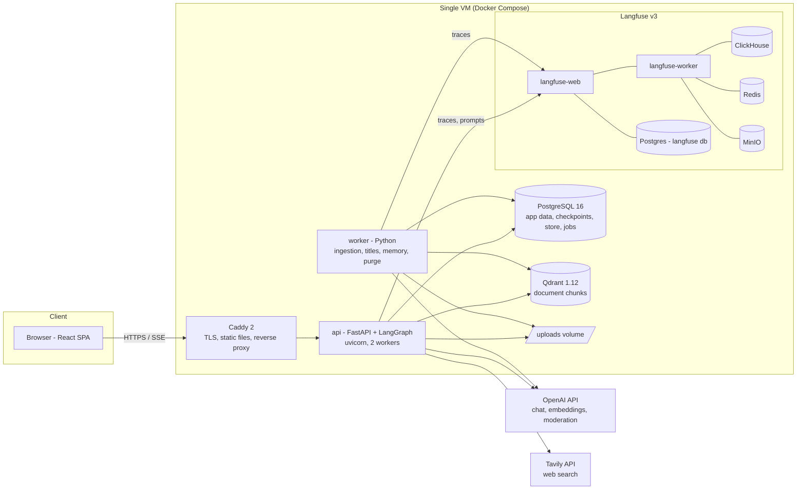
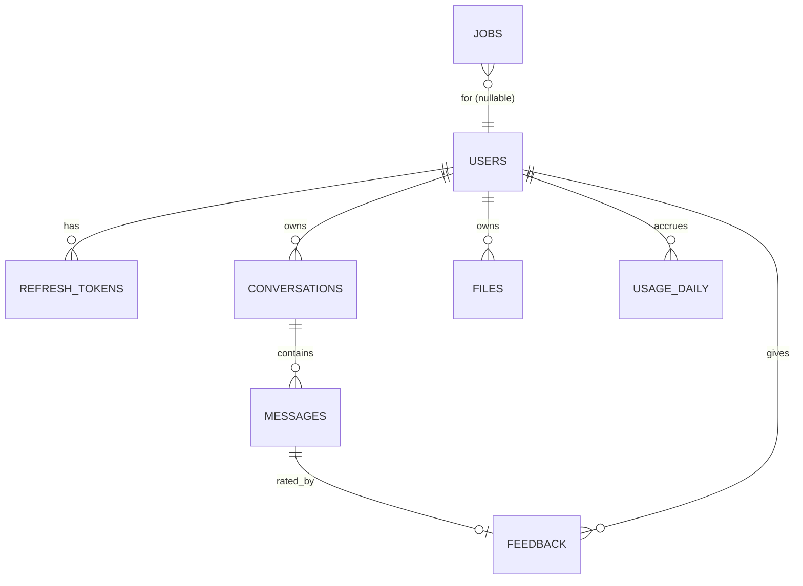

# Technical Architecture — Nexus AI

**Version:** 1.0 · **Date:** 2026-11-19 · **Related:** [PRD](01_prd.md), [Functional spec](02_functional_spec.md), [AI system design](08_ai_system_design.md), [Threat model](10_llm_threat_model.md)

## 1. System Overview



The API is stateless (all conversation state is in Postgres via the LangGraph checkpointer), so it can scale to more replicas later. Langfuse uses its own logical database on the same Postgres instance.

## 2. Component Breakdown

| Component | Technology | Responsibility | Exposes | Depends on |
|-----------|-----------|----------------|---------|------------|
| Web | React 18.3, Vite 6, TypeScript 5.6, Tailwind 3.4, shadcn/ui, TanStack Query 5, React Router 6, react-markdown + rehype-sanitize, Shiki | SPA: chat UI, files, settings | Static assets served by Caddy | API |
| Reverse proxy | Caddy 2.8 | TLS (Let's Encrypt), HTTP/2, gzip, static SPA, `/api/*` → api, SSE without buffering, security headers | :443 | api |
| API | Python 3.12, FastAPI 0.115, uvicorn, Pydantic 2, SQLAlchemy 2 (async, asyncpg), Alembic, LangGraph 0.4+, langchain-openai, langfuse SDK v3 | Auth, REST, SSE streaming, graph execution, rate limits | `/api/v1/*`, `/healthz`, `/readyz` | Postgres, Qdrant, OpenAI, Tavily, Langfuse |
| Worker | Same codebase, `python -m app.worker` | Jobs: `ingest_file`, `delete_file_vectors`, `generate_title`, `extract_memories`, `purge_user` | none (pulls jobs) | Postgres, Qdrant, OpenAI, Langfuse |
| PostgreSQL | 16 (`pgvector/pgvector:pg16` image — the memory store index needs pgvector) | App tables, LangGraph `AsyncPostgresSaver` (checkpoints) and `AsyncPostgresStore` (memories), job queue | :5432 (internal) | — |
| Qdrant | 1.12 | Vector search over document chunks with payload filters | :6333 (internal) | — |
| Langfuse | v3 (web + worker + ClickHouse + Redis + MinIO) | Tracing, prompt registry, datasets, scores, cost dashboards | :3000 (behind Caddy, admin-only via basic auth/IP allowlist) | — |
| OpenAI | `gpt-4.1`, `gpt-4.1-mini`, `text-embedding-3-small`, `omni-moderation-latest` | Generation, embeddings, moderation | — | — |
| Tavily | Search API | Web search tool | — | — |

**Backend module layout** (`backend/app/`):
`api/` (routers, deps, SSE) · `core/` (config, security, logging, rate limit, errors) · `db/` (models, session, repositories) · `graph/` (state, builder, nodes, tools) · `llm/` (model factory, prompt loader, moderation, tracing) · `rag/` (parsers, chunker, embedder, retriever) · `memory/` (store access, extraction) · `jobs/` (queue, handlers) · `worker.py` · `main.py`.

## 3. Data Architecture

### 3.1 ERD (application tables)



### 3.2 Core models

| Table | Fields (type) |
|-------|---------------|
| `users` | `id uuid pk`, `email citext unique`, `password_hash text` (argon2id), `display_name text`, `memory_enabled bool default true`, `status text` (active/pending_deletion), `created_at timestamptz`, `updated_at timestamptz` |
| `refresh_tokens` | `id uuid pk`, `user_id uuid fk`, `family_id uuid`, `token_hash text unique`, `expires_at timestamptz`, `revoked_at timestamptz null`, `created_at` |
| `conversations` | `id uuid pk`, `user_id uuid fk`, `title text`, `active_run_id uuid null`, `pending_interrupt jsonb null`, `summary text null`, `created_at`, `updated_at` |
| `messages` | `id uuid pk`, `conversation_id uuid fk`, `user_id uuid fk`, `role text` (user/assistant), `content text`, `status text` (complete/cancelled/failed), `tool_calls jsonb`, `citations jsonb`, `model text`, `prompt_tokens int`, `completion_tokens int`, `cost_usd numeric(10,6)`, `trace_id text`, `created_at` |
| `files` | `id uuid pk`, `user_id uuid fk`, `filename text`, `mime_type text`, `size_bytes int`, `sha256 char(64)`, `storage_path text`, `status text`, `error text null`, `page_count int`, `chunk_count int`, `created_at`, `updated_at` |
| `feedback` | `id uuid pk`, `message_id uuid fk unique(message_id,user_id)`, `user_id uuid fk`, `score smallint` (−1/1), `comment text null`, `created_at` |
| `usage_daily` | `user_id uuid`, `day date`, `prompt_tokens bigint`, `completion_tokens bigint`, `cost_usd numeric(12,6)`, `requests int`, pk(`user_id`,`day`) |
| `jobs` | `id bigserial pk`, `kind text`, `payload jsonb`, `idempotency_key text unique`, `status text` (queued/running/done/failed/cancelled), `attempts int`, `max_attempts int default 3`, `run_after timestamptz`, `locked_at timestamptz`, `locked_by text`, `last_error text`, `user_id uuid null`, `created_at` |

**Managed by LangGraph:** `checkpoints`, `checkpoint_blobs`, `checkpoint_writes` (thread_id = conversation id), `store` (namespace `("memories", user_id)`).

**Read model vs. graph state:** the checkpointer is the source of truth for the agent's state; `messages` is a denormalised read model written at run end (and on cancel), giving fast paginated history, feedback targets and per-message cost without deserialising checkpoints.

**Qdrant collection `documents`:** vector size 1536, cosine; payload `user_id` (keyword, indexed, `is_tenant=true`), `file_id` (keyword, indexed), `filename`, `page`, `chunk_index`, `text`. Point id = UUIDv5(file_id, chunk_index) → idempotent re-ingestion.

### 3.3 Indexing strategy
- `conversations (user_id, updated_at desc, id)` — sidebar pagination
- `messages (conversation_id, created_at, id)` — history pagination
- `files (user_id, created_at desc)`, unique `files (user_id, sha256)`
- `jobs (status, run_after) where status='queued'` — partial index for the dequeue query
- `refresh_tokens (user_id)`, `refresh_tokens (family_id)`

### 3.4 Migration strategy
Alembic, forward-only in production; each migration reviewed in PR; `alembic upgrade head` runs as a one-shot `migrate` service before `api`/`worker` start. LangGraph tables created via `checkpointer.setup()` / `store.setup()` inside the same migrate step. Destructive changes use expand → migrate data → contract over two releases.

## 4. API Design Principles

- **REST + SSE**, JSON, prefix `/api/v1`; breaking changes → `/api/v2`.
- Streaming endpoints return `text/event-stream` (see 08 §8 for event schemas); everything else is plain JSON.
- **Cursor pagination** everywhere: `?limit=30&cursor=<opaque>` → `{items, next_cursor}`; cursor = base64(`created_at|id`).
- Errors: `{"error": {"code": "SNAKE_UPPER", "message": "...", "details": {...}, "request_id": "..."}}`.
- Others' resources return **404** (not 403) to avoid enumeration.
- Idempotency: `Idempotency-Key` header supported on `POST /files` and message sends.

## 5. Authentication & Authorization Flow

```mermaid
sequenceDiagram
  participant B as Browser
  participant A as API
  participant DB as Postgres
  B->>A: POST /auth/login {email, password}
  A->>DB: fetch user, verify argon2id hash
  A->>DB: insert refresh_token (family F, hash)
  A-->>B: 200 {access_token (15 min)} + Set-Cookie refresh (httpOnly, Secure, SameSite=Strict, Path=/api/v1/auth)
  B->>A: GET /conversations (Authorization: Bearer access)
  A-->>B: 200
  Note over B,A: access token expires
  B->>A: POST /auth/refresh (cookie)
  A->>DB: find token by hash; if revoked → revoke family F, 401
  A->>DB: revoke old, insert new (family F)
  A-->>B: 200 {access_token} + new cookie
```

Authorization: every repository method takes `user_id` and filters on it; Qdrant searches always include a `user_id` filter; memory store namespace includes `user_id`. A test suite (`tests/backend/test_isolation.py`) asserts cross-user access fails for every resource.

## 6. Infrastructure & Deployment

| Env | Where | Notes |
|-----|-------|-------|
| dev | Developer machine, `docker compose up` (+ `vite dev`, `uvicorn --reload` optional) | Langfuse local or Langfuse Cloud via env |
| staging | VM #1, same compose file + `compose.prod.yml` override | Separate OpenAI project key with low limits |
| prod | VM #2 (4 vCPU / 8 GB / 80 GB SSD) | Daily Postgres dumps + Qdrant snapshots to off-site object storage |

- **Containers:** `caddy`, `web` (build stage only; output served by Caddy), `api`, `worker`, `migrate` (one-shot), `postgres`, `qdrant`, `langfuse-web`, `langfuse-worker`, `clickhouse`, `redis`, `minio`.
- **Secrets:** `.env` on the VM (root-only, 0600), injected via compose `env_file`; never baked into images. GitHub Actions secrets for deploy SSH key. Rotation documented in `memory/infra.md`.
- **Pipeline:** PR → lint, type-check, unit + integration tests (Postgres + Qdrant service containers), contract tests, `make eval-smoke`, build images. Merge to `main` → push images to GHCR → deploy to staging (SSH + `docker compose pull && up -d`) → Playwright smoke → manual approval → prod.

## 7. Observability

- **LLM tracing:** Langfuse — one trace per run (`chat.turn`, `chat.resume`, `job.ingest_file`, …), spans for nodes/tools/retrieval, generations with tokens and cost. Tags: `env`, `feature`, prompt name+version; `user_id` = HMAC-SHA256(user id).
- **Logs:** structlog JSON to stdout → Docker log driver (local rotation, 14 days). Fields: `ts`, `level`, `request_id`, `trace_id`, `user_hash`, `route`, `latency_ms`. Never message content.
- **Metrics:** `prometheus-fastapi-instrumentator` at `/metrics` (internal): request rate/latency, active streams, job queue depth, token usage counters.
- **Alerting:** Uptime Kuma (or Better Stack) on `/readyz`; alerts on error rate > 2% / 5 min, job queue depth > 100, OpenAI error rate > 10%, daily spend > threshold (Langfuse cost dashboard + cron check).

## 8. Security Considerations

- Threat model in [10_llm_threat_model.md](10_llm_threat_model.md).
- Input validation with Pydantic (strict types, max lengths); uploads validated by extension + magic bytes; parsing in the worker with size/page limits.
- Rate limiting: per-IP on auth endpoints, per-user on messages (Postgres token bucket); daily token budget.
- CORS: same-origin in prod (SPA and API behind one Caddy host); dev allows `http://localhost:5173` only.
- Headers via Caddy: strict CSP (`default-src 'self'; img-src 'self' data:; connect-src 'self'; frame-ancestors 'none'`), HSTS, `X-Content-Type-Options`, `Referrer-Policy: no-referrer`.
- Model output rendered with `rehype-sanitize`; no raw HTML; links `rel="noopener noreferrer nofollow"`.
- Dependencies: Dependabot + `pip-audit` + `npm audit` in CI; images scanned by Trivy.

## 9. Scalability & Performance

- **Bottleneck** is OpenAI latency/rate limits, not our compute. Mitigations: streaming, small models for background work, fallback model, per-user limits.
- Async everywhere (asyncpg, httpx, async Qdrant client). DB pool: 10 per API worker, 5 for the worker.
- SSE: Caddy `flush_interval -1`; heartbeat comment every 15 s; 20 concurrent streams per API worker fits comfortably.
- Embeddings batched (64 chunks/request); ingestion concurrency 2 per worker.
- Caching: memories for the current user cached per run; prompts cached by the Langfuse SDK (60 s TTL); static assets immutable with hashed filenames.
- Scale-out path: more `api`/`worker` replicas behind Caddy; Postgres and Qdrant to managed services.

## 10. ADR Candidates

| ADR | Decision |
|-----|----------|
| [0002](../../adr/0002-langgraph-orchestration.md) | LangGraph for agent orchestration with Postgres checkpointer |
| [0003](../../adr/0003-qdrant-and-postgres-storage.md) | Qdrant for vectors; Postgres for relational data, graph state and memories |
| [0004](../../adr/0004-langfuse-observability.md) | Self-hosted Langfuse for tracing, prompts, datasets, scores |
| [0005](../../adr/0005-openai-model-factory.md) | OpenAI behind a single model factory |
| [0006](../../adr/0006-sse-streaming-protocol.md) | SSE with typed events for streaming |
| [0007](../../adr/0007-postgres-job-queue.md) | Postgres-backed job queue instead of a broker |
