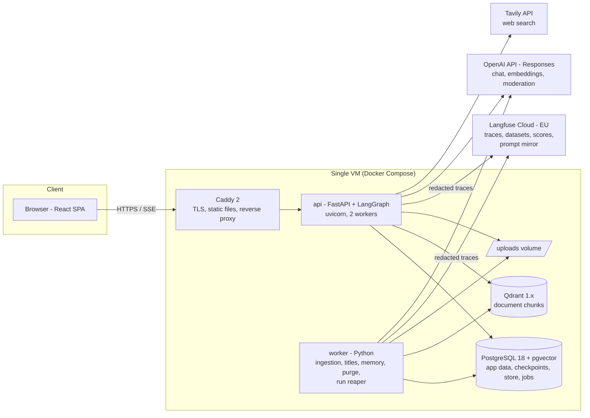
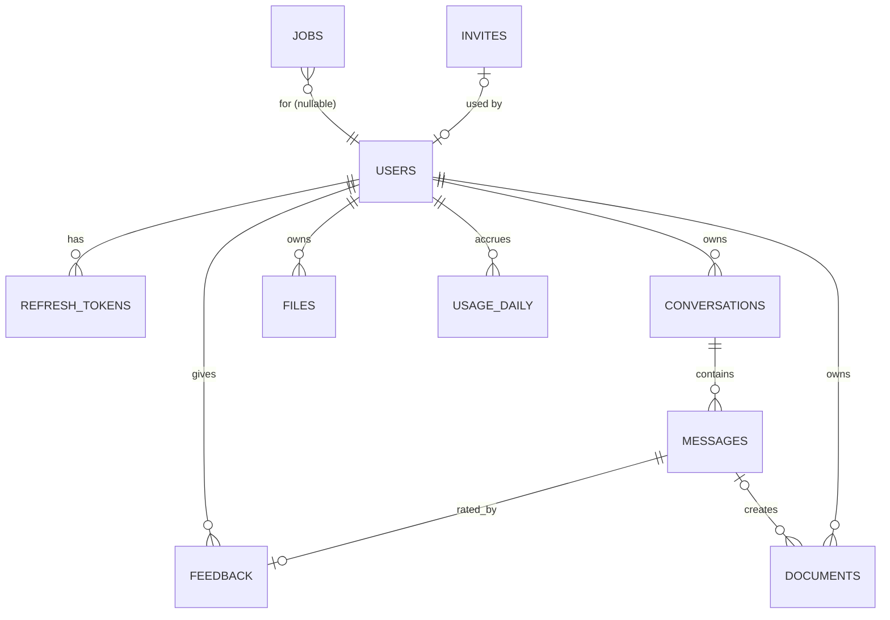

# Technical Architecture — Nexus AI

**Version:** 1.3 · **Date:** 2026-11-21 (task 003b: schedules removed, `runtime_flags`, job heartbeat) · previous 1.2 2026-11-21 (v1.1: routing, documents; ADR-0010), 1.1 2026-11-19 (task 003) · **Related:** [PRD](01_prd.md), [Functional spec](02_functional_spec.md), [AI system design](08_ai_system_design.md), [Threat model](10_llm_threat_model.md)

## 1. System Overview



The API holds no conversation state in memory between requests (all of it is in Postgres via the LangGraph checkpointer), so it can scale to more replicas later. A run in progress is an asyncio task in one API process; it holds a lease in Postgres so a restart never leaves it locked (ADR-0006).

Langfuse is not part of the default stack: dev, CI and prod send redacted traces to **Langfuse Cloud (EU region)**. Self-hosters can enable a self-hosted **Langfuse v4** with `docker compose --profile langfuse up` (it needs ≥ 4 cores / 16 GiB on its own; ADR-0004).

## 2. Component Breakdown

| Component | Technology | Responsibility | Exposes | Depends on |
|-----------|-----------|----------------|---------|------------|
| Web | React 19, Vite 8, TypeScript 5.9, Tailwind 4, shadcn/ui, TanStack Query 5, React Router 8 (SPA / declarative mode), react-markdown + rehype-sanitize, Shiki; hand-written SSE client | SPA: chat UI, files, settings | Static assets served by Caddy | API |
| Reverse proxy | Caddy 2.11 | TLS (Let's Encrypt), HTTP/2, gzip, static SPA, `/api/*` → api, SSE without buffering, security headers | :443 | api |
| API | Python 3.14, FastAPI 0.16x, uvicorn, Pydantic 2, SQLAlchemy 2 (async, **psycopg 3**), Alembic, LangGraph 1.x, langchain-openai 1.x (Responses API), Langfuse SDK v5 | Auth + invites, REST, SSE streaming, graph execution, run lease, rate limits and budgets | `/api/v1/*`, `/healthz`, `/readyz` | Postgres, Qdrant, OpenAI, Tavily, Langfuse |
| Worker | Same codebase, `python -m app.worker` | Jobs: `ingest_file`, `delete_file_vectors`, `generate_title`, `extract_memories`, `purge_user`, `render_document` (WeasyPrint, v1.1); periodic: `reap_stale_runs` (30 s), `requeue_stale_jobs` (30 s), `cleanup_invites` (daily), `cleanup_rate_limits` (daily), `cleanup_documents` (daily, v1.1). Running jobs heartbeat every 30 s (ADR-0007) | none (pulls jobs) | Postgres, Qdrant, OpenAI, Langfuse |
| CLI | Same codebase, `python -m app.cli` | Admin: invites, password reset, disable/enable user, kill switches (`flags set/list`); `seed`, `dump-thread` | — | Postgres |
| PostgreSQL | 18 (`pgvector/pgvector:pg18` image — the memory store index needs pgvector) | App tables, LangGraph `AsyncPostgresSaver` (checkpoints) and `AsyncPostgresStore` (memories), job queue | :5432 (internal) | — |
| Qdrant | 1.x (1.20 at time of writing) | Vector search over document chunks with payload filters (`query_points`) | :6333 (internal) | — |
| Langfuse | Langfuse Cloud, EU region, Hobby plan (optional self-hosted v4 profile) | Tracing, datasets, scores, prompt-version mirror (prompts are canonical in the repo, ADR-0008) | external HTTPS | — |
| OpenAI | Models per [08 §3](08_ai_system_design.md): `gpt-6.1-terra` (chat, bake-off vs `gpt-5.4-mini`), `gpt-6-luna`, `text-embedding-3-small`, `omni-moderation-latest` | Generation, embeddings, moderation | — | — |
| Tavily | Search API | Web search tool | — | — |

**Backend module layout** (`backend/app/`):
`api/` (routers, deps, SSE) · `core/` (config, runtime flags, security, logging, rate limit, budgets, errors) · `db/` (models, session, repositories) · `graph/` (state, builder, nodes, tools, `commands.py` slash-command parser, `router.py`, `intents/` one module per intent subgraph) · `llm/` (model factory, fake model, prompt loader, pricing, moderation, tracing) · `rag/` (parsers, chunker, embedder, retriever) · `documents/` (draft → sanitised HTML → PDF, templates, deny-all URL fetcher) · `memory/` (store access, extraction) · `jobs/` (queue, handlers, periodic tasks) · `services/` (runs + lease, files, usage) · `cli.py` · `worker.py` · `main.py`.

## 3. Data Architecture

### 3.1 ERD (application tables)



### 3.2 Core models

| Table | Fields (type) |
|-------|---------------|
| `users` | `id uuid pk`, `email citext unique`, `password_hash text` (argon2id), `display_name text`, `memory_enabled bool default true`, `status text` (active/disabled/pending_deletion), `created_at timestamptz`, `updated_at timestamptz` |
| `invites` | `id uuid pk`, `code_hash text unique` (SHA-256 of the code), `note text null`, `expires_at timestamptz`, `used_at timestamptz null`, `used_by uuid null fk users`, `revoked_at timestamptz null`, `created_at` |
| `refresh_tokens` | `id uuid pk`, `user_id uuid fk`, `family_id uuid`, `token_hash text unique`, `expires_at timestamptz`, `revoked_at timestamptz null`, `created_at` |
| `conversations` | `id uuid pk`, `user_id uuid fk`, `title text`, `active_run_id uuid null`, `run_heartbeat_at timestamptz null`, `pending_interrupt jsonb null`, `created_at`, `updated_at` |
| `messages` | `id uuid pk`, `conversation_id uuid fk`, `user_id uuid fk`, `role text` (user/assistant), `content text`, `status text` (complete/cancelled/failed), `finish_reason text null`, `tool_calls jsonb`, `citations jsonb`, `model text`, `prompt_tokens int`, `cached_tokens int`, `completion_tokens int` (includes reasoning tokens), `cost_usd numeric(10,6)`, `trace_id text`, `intent text null` (v1.1), `route_source text null` (router/command/fallback, v1.1), `created_at` |
| `files` | `id uuid pk`, `user_id uuid fk`, `filename text`, `mime_type text`, `size_bytes int`, `sha256 char(64)`, `storage_path text`, `status text`, `error text null`, `page_count int`, `chunk_count int`, `created_at`, `updated_at` |
| `documents` (v1.1) | `id uuid pk`, `user_id uuid fk`, `conversation_id uuid null fk (on delete set null)`, `message_id uuid null fk (on delete set null)`, `kind text` (thread_summary/answer/news_brief/research_report; `last_answer` gives `research_report` when the answer was a research report, else `answer`), `title text`, `draft jsonb` (`DocumentDraft`), `status text` (pending/ready/failed), `storage_path text null`, `page_count int null`, `size_bytes int null`, `error text null`, `created_at`, `updated_at` |
| `feedback` | `id uuid pk`, `message_id uuid fk unique(message_id,user_id)`, `user_id uuid fk`, `score smallint` (−1/1), `comment text null`, `created_at` |
| `usage_daily` | `user_id uuid`, `day date`, `prompt_tokens bigint`, `completion_tokens bigint`, `cost_usd numeric(12,6)`, `requests int`, pk(`user_id`,`day`) |
| `jobs` | `id bigserial pk`, `kind text`, `payload jsonb`, `idempotency_key text unique`, `status text` (queued/running/done/failed/cancelled), `attempts int`, `max_attempts int default 3`, `run_after timestamptz`, `locked_at timestamptz` (heartbeat: refreshed every 30 s while running), `locked_by text`, `last_error text`, `user_id uuid null`, `created_at` |
| `runtime_flags` | `name text pk` (e.g. `ROUTER_DISABLED`, `TOOLS_DISABLED`), `value text`, `updated_at timestamptz`, `updated_by text` (CLI user) |

**Managed by LangGraph:** `checkpoints`, `checkpoint_blobs`, `checkpoint_writes` (thread_id = conversation id), `store` (namespace `("memories", user_id)`).

**Read model vs. graph state:** the checkpointer is the source of truth for the agent's state, including the rolling summary (there is no `summary` column); `messages` is a denormalised read model written at run end (and on cancel, failure or reaping), giving fast paginated history, feedback targets and per-message cost without deserialising checkpoints.

**Run lease:** `active_run_id` + `run_heartbeat_at` (updated every 10 s by the API while a run executes). The worker's `reap_stale_runs` clears leases older than 60 s and writes a `failed` assistant message (`finish_reason=server_restart`). See ADR-0006.

**Qdrant collection `documents`:** vector size 1536, cosine; payload `user_id` (keyword, indexed, `is_tenant=true`), `file_id` (keyword, indexed), `filename`, `page`, `chunk_index`, `text`. Point id = UUIDv5(file_id, chunk_index) → idempotent re-ingestion.

### 3.3 Indexing strategy
- `conversations (user_id, updated_at desc, id)` — sidebar pagination
- `conversations (run_heartbeat_at) where active_run_id is not null` — partial index for the reaper
- unique `invites (code_hash)`
- `messages (conversation_id, created_at, id)` — history pagination
- `files (user_id, created_at desc)`, unique `files (user_id, sha256)`
- `documents (user_id, created_at desc)`; `documents (user_id, created_at)` also serves the 10/day count (v1.1)
- `jobs (status, run_after) where status='queued'` — partial index for the dequeue query; `jobs (locked_at) where status='running'` — stale-job requeue
- `refresh_tokens (user_id)`, `refresh_tokens (family_id)`

### 3.4 Migration strategy
Alembic, forward-only in production; each migration reviewed in PR; `alembic upgrade head` runs as a one-shot `migrate` service before `api`/`worker` start. LangGraph tables created via `checkpointer.setup()` / `store.setup()` inside the same migrate step. All connections use psycopg 3 (`postgresql+psycopg://` for SQLAlchemy; a psycopg async pool for LangGraph). Destructive changes use expand → migrate data → contract over two releases.

## 4. API Design Principles

- **REST + SSE**, JSON, prefix `/api/v1`; breaking changes → `/api/v2`.
- Streaming endpoints return `text/event-stream` (see 08 §8 for event schemas); everything else is plain JSON.
- **Cursor pagination** everywhere: `?limit=30&cursor=<opaque>` → `{items, next_cursor}`; cursor = base64(`created_at|id`).
- Errors: `{"error": {"code": "SNAKE_UPPER", "message": "...", "details": {...}, "request_id": "..."}}`.
- Others' resources return **404** (not 403) to avoid enumeration.
- Idempotency: `Idempotency-Key` header supported on `POST /files` and message sends.

## 5. Authentication & Authorization Flow

```mermaid
sequenceDiagram
  participant B as Browser
  participant A as API
  participant DB as Postgres
  Note over B,A: Registration (once): POST /auth/register {invite_code, email, password, display_name}<br/>invite must be unused, unexpired, unrevoked (REGISTRATION_MODE=invite)
  B->>A: POST /auth/login {email, password}
  A->>DB: fetch user, verify argon2id hash
  A->>DB: insert refresh_token (family F, hash)
  A-->>B: 200 {access_token (15 min)} + Set-Cookie refresh (httpOnly, Secure, SameSite=Strict, Path=/api/v1/auth)
  B->>A: GET /conversations (Authorization: Bearer access)
  A-->>B: 200
  Note over B,A: access token expires
  B->>A: POST /auth/refresh (cookie)
  A->>DB: find token by hash; if revoked → revoke family F, 401
  A->>DB: revoke old, insert new (family F)
  A-->>B: 200 {access_token} + new cookie
```

Authorization: every repository method takes `user_id` and filters on it; Qdrant searches always include a `user_id` filter; memory store namespace includes `user_id`. A test suite (`tests/backend/test_isolation.py`) asserts cross-user access fails for every resource.

## 6. Infrastructure & Deployment

| Env | Where | Notes |
|-----|-------|-------|
| dev | Developer machine, `docker compose up` (+ `vite dev`, `uvicorn --reload` optional) | Langfuse Cloud dev project; `LLM_MODE=fake` available offline |
| CI ("staging") | GitHub Actions runner | Full compose stack with `LLM_MODE=fake` + Playwright smoke; eval smoke with real models on a capped OpenAI project key; Langfuse Cloud CI project |
| prod | One VM (4 vCPU / 8 GB / 80 GB SSD), invite-only | Nightly Postgres dump + Qdrant snapshot to off-site object storage; restore tested once |

There is no staging VM: CI runs the whole stack the way prod does, and prod deploys are manual.

- **Containers:** `caddy`, `web` (build stage only; output served by Caddy), `api` (`stop_grace_period: 120s` for run drain), `worker`, `migrate` (one-shot), `postgres`, `qdrant`. Optional profile `langfuse`: `langfuse-web`, `langfuse-worker`, `clickhouse`, `redis`, `minio`, `langfuse-postgres`.
- **Secrets:** `.env` on the VM (root-only, 0600), injected via compose `env_file`; never baked into images. GitHub Actions secrets for the deploy SSH key and the CI OpenAI/Langfuse keys. Rotation documented in `memory/infra.md`.
- **Pipeline:** PR → lint, type-check, unit + integration tests (Postgres + Qdrant service containers), contract tests, full-stack Playwright smoke with the fake LLM, `make eval-smoke` (AI changes), build images. Merge to `main` → same checks → push images to GHCR → CI pushes changed prompts to Langfuse (ADR-0008). **Deploy:** manually dispatched `deploy.yml` (SSH + `docker compose pull && up -d`) → post-deploy smoke against `/readyz`.

## 7. Observability

- **LLM tracing:** Langfuse Cloud (EU) — one trace per run (`chat.turn`, `chat.resume`, `job.ingest_file`, `job.render_document`, …), tagged with `intent:<intent>` (v1.1), spans for nodes/tools/retrieval, generations with tokens and cost. Tags: `env`, `feature`, prompt name+version; `user_id` = HMAC-SHA256(user id). Content passes through the `mask` redaction function before export. Best-effort: tracing failures never fail a run.
- **Logs:** structlog JSON to stdout → Docker log driver (local rotation, 14 days). Fields: `ts`, `level`, `request_id`, `trace_id`, `user_hash`, `route`, `latency_ms`. Never message content.
- **Metrics:** deferred (no Prometheus in v1). Queue depth, active runs and spend are queryable with SQL and visible in Langfuse.
- **Alerting (no SLO):** one external uptime check on `/readyz`; a daily-spend alert when global spend reaches 80% of the global cap; the weekly full-eval workflow alerts on failure.

## 8. Security Considerations

- Threat model in [10_llm_threat_model.md](10_llm_threat_model.md).
- Input validation with Pydantic (strict types, max lengths); uploads validated by extension + magic bytes; parsing in the worker with size/page limits.
- Rate limiting: per-IP on auth endpoints (including invite attempts), per-user on messages (Postgres token bucket); per-user and global daily spend budgets in USD.
- Registration is invite-only by default; invite codes are high-entropy, single-use, expiring and stored hashed.
- CORS: same-origin in prod (SPA and API behind one Caddy host); dev allows `http://localhost:5173` only.
- Headers via Caddy: strict CSP (`default-src 'self'; img-src 'self' data:; connect-src 'self'; frame-ancestors 'none'`), HSTS, `X-Content-Type-Options`, `Referrer-Policy: no-referrer`.
- Model output rendered with `rehype-sanitize`; no raw HTML; links `rel="noopener noreferrer nofollow"`.
- Kill switches are rows in `runtime_flags`, set with `python -m app.cli flags set <NAME>=<value>` and read by the API and worker through a 60 s cache; env values only provide boot defaults (doc 10 §3). No restart or drain is needed to flip one.
- Generated PDFs (v1.1): rendered in the worker from sanitised HTML with a deny-all URL fetcher (bundled CSS/fonts only); served only through the authenticated download endpoint with `Content-Disposition: attachment` and `X-Content-Type-Options: nosniff`.
- Dependencies: Dependabot + `pip-audit` + `npm audit` in CI; images scanned by Trivy.

## 9. Scalability & Performance

- **Bottleneck** is OpenAI latency/rate limits, not our compute. Mitigations: streaming, small models for background work, fallback model, per-user limits.
- Async everywhere (psycopg 3 async, httpx, async Qdrant client). DB pool: 10 per API worker, 5 for the worker (plus the LangGraph psycopg pool, 5 per API worker).
- SSE: Caddy `flush_interval -1`; heartbeat comment every 15 s; 20 concurrent streams per API worker fits comfortably.
- Embeddings batched (64 chunks/request); ingestion concurrency 2 per worker.
- Caching: OpenAI prompt caching is the main cost lever — prompts are laid out stable-first (08 §4) so the history prefix is reused across turns; memories for the current user cached per run; prompts loaded from disk once per process; static assets immutable with hashed filenames.
- Scale-out path: more `api`/`worker` replicas behind Caddy; Postgres and Qdrant to managed services.

## 10. ADR Candidates

| ADR | Decision |
|-----|----------|
| [0002](../../adr/0002-langgraph-orchestration.md) | LangGraph for agent orchestration with Postgres checkpointer |
| [0003](../../adr/0003-qdrant-and-postgres-storage.md) | Qdrant for vectors; Postgres for relational data, graph state and memories |
| [0004](../../adr/0004-langfuse-observability.md) | Langfuse Cloud (EU) by default for tracing, datasets, scores; self-hosted v4 optional |
| [0005](../../adr/0005-openai-model-factory.md) | OpenAI behind a single model factory (reasoning effort per role, Responses API, fake mode) |
| [0006](../../adr/0006-sse-streaming-protocol.md) | SSE with typed events; run lease, reaper and graceful drain |
| [0007](../../adr/0007-postgres-job-queue.md) | Postgres-backed job queue instead of a broker |
| [0008](../../adr/0008-repo-canonical-prompts.md) | Prompts are canonical in the repo; Langfuse mirrors them |
| [0009](../../adr/0009-two-tier-quality-gates.md) | Two-tier quality gates: targets vs. measured baselines |
| [0010](../../adr/0010-intent-router.md) | Intent router in front of per-intent subgraphs (v1.1) |
