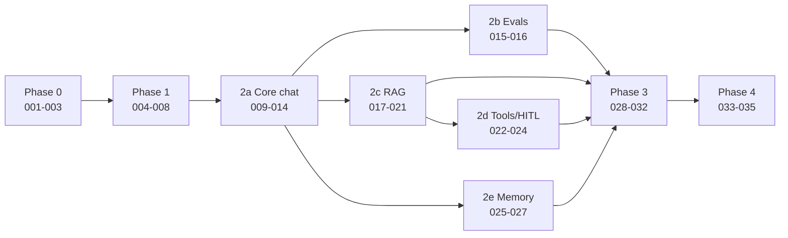

# Implementation Plan — Nexus AI v1

**Version:** 1.0 · **Date:** 2026-11-19 · **Inputs:** [PRD](01_prd.md), [Architecture](03_tech_architecture.md), [API](04_api_spec.yaml), [AI design](08_ai_system_design.md), [Eval plan](09_eval_plan.md), [Threat model](10_llm_threat_model.md)

Each TASK below becomes `tasks/active/<NNN>-<slug>.md` when started (repo task numbers continue from 003). Roadmap groups from the planning session are shown in brackets.

---

## Phase 0 — Project Setup  [003-skeleton]

#### TASK-001: Monorepo tooling
- **Phase:** 0 · **Depends on:** none
- **Files:** `backend/pyproject.toml`, `backend/uv.lock`, `frontend/package.json`, `.pre-commit-config.yaml`, `Makefile`
- **Description:** Initialise the backend with uv (ruff, mypy --strict, pytest, pytest-asyncio, coverage) and the frontend with Vite React-TS (eslint, prettier, vitest). Add `make lint`, `make test`, `make fmt`.
- **Acceptance criteria:**
  - [ ] `make lint` and `make test` pass on an empty project
  - [ ] pre-commit runs ruff, prettier, and a secrets scanner (gitleaks)

#### TASK-002: Docker Compose stack
- **Phase:** 0 · **Depends on:** TASK-001
- **Files:** `compose.yml`, `compose.prod.yml`, `backend/Dockerfile`, `frontend/Dockerfile`, `deploy/Caddyfile`, `.env.example`
- **Description:** Compose services: caddy, api, worker, migrate, postgres, qdrant, and Langfuse v3 (web, worker, clickhouse, redis, minio) with healthchecks and named volumes. Multi-stage, non-root images.
- **Acceptance criteria:**
  - [ ] `make up` brings every service to healthy in < 3 min on a clean machine
  - [ ] Langfuse UI reachable on `http://localhost:3000`; API at `http://localhost:8000/api/v1/healthz`

#### TASK-003: CI pipeline
- **Phase:** 0 · **Depends on:** TASK-001 · *parallel with TASK-002*
- **Files:** `.github/workflows/ci.yml`, `.github/dependabot.yml`
- **Description:** Run lint, type-check, unit and integration tests (Postgres + Qdrant service containers), contract tests, eval-smoke (on `main` and labelled PRs), and image builds. Add pip-audit, npm audit and Trivy.
- **Acceptance criteria:**
  - [ ] Pipeline is green on the first PR; required checks enforced on `main`

## Phase 1 — Core Infrastructure  [003-skeleton]

#### TASK-004: Config, logging, errors
- **Phase:** 1 · **Depends on:** TASK-001
- **Files:** `backend/app/core/{config,logging,errors}.py`, `backend/app/main.py`
- **Description:** pydantic-settings config from env; structlog JSON logging with a request-id middleware; error envelope and exception handlers matching the `Error` schema.
- **Acceptance criteria:**
  - [ ] Unknown routes return the error envelope with `request_id`
  - [ ] Logs carry no request bodies

#### TASK-005: Database layer & migrations
- **Phase:** 1 · **Depends on:** TASK-004
- **Files:** `backend/app/db/{session,models,base}.py`, `backend/alembic/`, `backend/app/db/repositories/`
- **Description:** Async SQLAlchemy models for all tables in architecture §3.2, the initial Alembic migration, and LangGraph checkpointer/store setup in the migrate step. Repository functions all take `user_id`.
- **Acceptance criteria:**
  - [ ] `alembic upgrade head` on an empty DB creates all tables and indexes
  - [ ] The migrate service is idempotent

#### TASK-006: Auth
- **Phase:** 1 · **Depends on:** TASK-005
- **Files:** `backend/app/api/auth.py`, `backend/app/core/security.py`, `backend/app/api/me.py`, `backend/tests/api/test_auth.py`
- **Description:** Register, login, refresh (rotation + family revocation), logout; argon2id hashing; JWT (HS256, 15 min); `/me` GET/PATCH, password change; auth rate limits.
- **Acceptance criteria:**
  - [ ] Refresh-token reuse revokes the whole family (tested)
  - [ ] Login does not reveal whether an email exists
  - [ ] Contract tests for the auth endpoints pass
- > **ADR needed:** none (covered by architecture §5)

#### TASK-007: Frontend shell
- **Phase:** 1 · **Depends on:** TASK-001 · *parallel with TASK-004–006*
- **Files:** `frontend/src/{main,App}.tsx`, `frontend/src/routes/`, `frontend/src/api/` (generated), `frontend/src/lib/auth.ts`, `frontend/src/styles/tokens.css`, `tailwind.config.ts`
- **Description:** Router with the screens from functional spec §3; `npm run gen:api` (openapi-typescript); auth context with in-memory access token and silent refresh; design tokens from doc 07; light/dark/system theme.
- **Acceptance criteria:**
  - [ ] Login/register work end-to-end against the API
  - [ ] Playwright `auth.spec.ts` passes

#### TASK-008: Conversations CRUD
- **Phase:** 1 · **Depends on:** TASK-006
- **Files:** `backend/app/api/conversations.py`, `frontend/src/components/sidebar/`
- **Description:** List, create, get, rename and delete conversations with cursor pagination; sidebar with infinite scroll and rename/delete menu.
- **Acceptance criteria:**
  - [ ] Cross-user access returns 404 (isolation test)
  - [ ] Sidebar e2e test passes

## Phase 2 — Feature Implementation

### 2a Core chat  [004-core-chat]

#### TASK-009: Model factory, prompt loader, tracing
- **Phase:** 2a · **Depends on:** TASK-004
- **Files:** `backend/app/llm/{factory,prompts,tracing,pricing}.py`, `backend/prompts/*.md` (fallbacks)
- **Description:** `get_chat_model(role)` with timeout, retries, fallback and the Langfuse callback; prompt loader that reads from Langfuse with a pinned-label fallback to repo files; HMAC user hashing; cost table.
- **Acceptance criteria:**
  - [ ] Unit tests with a fake model; the loader falls back to the repo copy when Langfuse is down
- > **ADR needed:** ADR-0005 (written)

#### TASK-010: Chat graph v1
- **Phase:** 2a · **Depends on:** TASK-005, TASK-009
- **Files:** `backend/app/graph/{state,builder}.py`, `backend/app/graph/nodes/{load_context,agent,summarize}.py`
- **Description:** The LangGraph graph from doc 08 without tools; `AsyncPostgresSaver`; trimming and summarisation.
- **Acceptance criteria:**
  - [ ] Graph unit tests with `FakeMessagesListChatModel` cover a multi-turn thread and summarisation triggering

#### TASK-011: SSE streaming endpoint
- **Phase:** 2a · **Depends on:** TASK-010, TASK-008
- **Files:** `backend/app/api/chat.py`, `backend/app/api/sse.py`, `backend/app/services/runs.py`
- **Description:** `POST /conversations/{id}/messages` streams typed events; one active run per conversation; cancel; regenerate; messages read model persisted at run end; per-message usage.
- **Acceptance criteria:**
  - [ ] Event order matches the spec (contract test parses the stream)
  - [ ] Cancel persists the partial answer as `cancelled`
  - [ ] Client disconnect does not kill the run
- > **ADR needed:** ADR-0006 (written)

#### TASK-012: Job queue & worker
- **Phase:** 2a · **Depends on:** TASK-005 · *parallel with TASK-010*
- **Files:** `backend/app/jobs/{queue,handlers}.py`, `backend/app/worker.py`
- **Description:** Postgres SKIP LOCKED queue with retries, backoff, idempotency keys and graceful shutdown; `generate_title` handler.
- **Acceptance criteria:**
  - [ ] Two workers never process the same job (concurrency test)
  - [ ] A title appears after the first exchange
- > **ADR needed:** ADR-0007 (written)

#### TASK-013: Chat UI
- **Phase:** 2a · **Depends on:** TASK-011, TASK-007
- **Files:** `frontend/src/api/stream.ts`, `frontend/src/features/chat/*`
- **Description:** Stream client (fetch-event-source) typed from the generated `StreamEvent`; message list with sanitised markdown, Shiki code blocks and copy; composer with send/stop; regenerate; error states.
- **Acceptance criteria:**
  - [ ] Playwright `chat.spec.ts` (against a stubbed LLM): send, stream, stop, regenerate

#### TASK-014: Moderation, rate limits, budgets
- **Phase:** 2a · **Depends on:** TASK-011
- **Files:** `backend/app/llm/moderation.py`, `backend/app/core/ratelimit.py`, `backend/app/services/usage.py`, `backend/app/api/me.py`
- **Description:** Input moderation before runs; per-user message rate limit; daily token budget; `/me/usage`; usage meter in the sidebar.
- **Acceptance criteria:**
  - [ ] Exceeding the budget returns 429 `BUDGET_EXCEEDED` with `Retry-After`

### 2b Eval harness  [005-eval-harness]

#### TASK-015: Eval runner
- **Phase:** 2b · **Depends on:** TASK-010
- **Files:** `backend/evals/{run,judges,metrics}.py`, `evals/datasets/*.jsonl`
- **Description:** Run the graph against JSONL datasets (synced to Langfuse datasets), score with metrics and judges from doc 09, write `evals/results/latest.json`, and log runs to Langfuse. `--suite smoke|full`.
- **Acceptance criteria:**
  - [ ] `make eval-smoke` runs in < 2 min and gates on the baseline
  - [ ] Chat datasets are seeded

#### TASK-016: Feedback
- **Phase:** 2b · **Depends on:** TASK-011
- **Files:** `backend/app/api/feedback.py`, `frontend/src/features/chat/Feedback.tsx`
- **Description:** `PUT /messages/{id}/feedback` stores the rating and sends a Langfuse score on the message's trace.
- **Acceptance criteria:**
  - [ ] The score is visible on the Langfuse trace

### 2c Files & RAG  [006-rag]

#### TASK-017: Upload API & storage
- **Phase:** 2c · **Depends on:** TASK-012
- **Files:** `backend/app/api/files.py`, `backend/app/services/files.py`
- **Description:** Multipart upload with size/type/magic-byte checks, SHA-256 dedupe, per-user limit; store on the uploads volume; enqueue `ingest_file`.
- **Acceptance criteria:**
  - [ ] All validation errors from functional spec FS-004 are covered by tests

#### TASK-018: Ingestion pipeline
- **Phase:** 2c · **Depends on:** TASK-017
- **Files:** `backend/app/rag/{parsers,chunker,embedder,index}.py`
- **Description:** Parse PDF (pypdf), DOCX (python-docx), TXT/MD; token-aware chunking (800/120); batched embeddings; idempotent Qdrant upsert with tenant payload; status updates.
- **Acceptance criteria:**
  - [ ] Re-running a job produces no duplicates
  - [ ] A failed parse sets status `failed` with a readable reason
- > **ADR needed:** ADR-0003 (written)

#### TASK-019: Retrieval tool & citations
- **Phase:** 2c · **Depends on:** TASK-018, TASK-010
- **Files:** `backend/app/rag/retriever.py`, `backend/app/graph/tools/search_my_files.py`, `backend/app/graph/nodes/tools.py`
- **Description:** `search_my_files` with a mandatory `user_id` filter; returns numbered passages wrapped as untrusted data; emits citation events.
- **Acceptance criteria:**
  - [ ] Isolation test: user B never retrieves user A's chunks
  - [ ] RAG eval meets the baseline

#### TASK-020: File deletion
- **Phase:** 2c · **Depends on:** TASK-018
- **Files:** `backend/app/api/files.py`, `backend/app/jobs/handlers.py`
- **Description:** Delete Qdrant points by `file_id`, then the disk file, then the row; cancel in-flight ingestion.
- **Acceptance criteria:**
  - [ ] A deleted file is never returned by search (tested)

#### TASK-021: Files UI
- **Phase:** 2c · **Depends on:** TASK-017, TASK-013 · *parallel with TASK-018*
- **Files:** `frontend/src/features/files/*`, composer attach button, citation chips
- **Description:** Upload with progress, status polling, files page, citation chips with snippet popovers.
- **Acceptance criteria:**
  - [ ] Playwright `rag.spec.ts`: upload → ready → cited answer

### 2d Tools & HITL  [007-tools-hitl]

#### TASK-022: Calculator & web search tools
- **Phase:** 2d · **Depends on:** TASK-019
- **Files:** `backend/app/graph/tools/{calculator,web_search}.py`
- **Description:** A safe AST-based calculator (no eval); Tavily search with a 10 s timeout, a cap of 5 results and domain metadata; results wrapped as untrusted.
- **Acceptance criteria:**
  - [ ] Calculator fuzz tests show no code execution
  - [ ] Tool-selection eval meets the baseline

#### TASK-023: Interrupt / resume flow
- **Phase:** 2d · **Depends on:** TASK-022, TASK-011
- **Files:** `backend/app/graph/nodes/approval.py`, `backend/app/api/chat.py` (resume), `frontend/src/features/chat/ApprovalCard.tsx`
- **Description:** `interrupt()` before `web_search`; `pending_interrupt` persisted on the conversation; resume with approve/edit/reject; 24 h expiry; card restored on reload.
- **Acceptance criteria:**
  - [ ] Playwright `tools.spec.ts`: approve, edit and reject paths, plus reload mid-approval

#### TASK-024: Tool-call UI
- **Phase:** 2d · **Depends on:** TASK-013
- **Files:** `frontend/src/features/chat/ToolCard.tsx`
- **Description:** Render `tool_start`/`tool_end` with name, args and status; stored `tool_calls` shown in history.
- **Acceptance criteria:**
  - [ ] Component tests for every status

### 2e Long-term memory  [008-long-term-memory]

#### TASK-025: Memory store & extraction job
- **Phase:** 2e · **Depends on:** TASK-012, TASK-010
- **Files:** `backend/app/memory/{store,extract}.py`, `backend/app/jobs/handlers.py`
- **Description:** `AsyncPostgresStore` with namespace `("memories", user_id)` and embedding index; `extract_memories` job after each turn (gpt-4.1-mini, structured output: create/update/delete ops); deny-list of sensitive categories.
- **Acceptance criteria:**
  - [ ] Memory extraction eval meets the baseline
  - [ ] Nothing is stored when memory is disabled

#### TASK-026: Memory in context & remember_fact tool
- **Phase:** 2e · **Depends on:** TASK-025
- **Files:** `backend/app/graph/nodes/load_context.py`, `backend/app/graph/tools/remember_fact.py`
- **Description:** Inject the top-k relevant memories into the system prompt as untrusted user-profile data; tool for explicit "remember / forget" requests; `memory_updated` event.
- **Acceptance criteria:**
  - [ ] "Forget X" removes X (eval case)
  - [ ] Isolation test passes

#### TASK-027: Memories API & UI
- **Phase:** 2e · **Depends on:** TASK-025, TASK-007
- **Files:** `backend/app/api/memories.py`, `frontend/src/features/settings/Memory.tsx`
- **Description:** CRUD endpoints plus clear-all; settings page with toggle, inline edit and delete; toast after extraction.
- **Acceptance criteria:**
  - [ ] Playwright `memory.spec.ts` passes

## Phase 3 — Quality & Hardening  [009-hardening]

#### TASK-028: Account export & deletion
- **Phase:** 3 · **Depends on:** TASK-020, TASK-025
- **Files:** `backend/app/api/me.py`, `backend/app/jobs/handlers.py` (`purge_user`)
- **Description:** JSON export; deletion revokes sessions and enqueues a purge across Postgres, checkpoints, store, Qdrant and disk.
- **Acceptance criteria:**
  - [ ] Purge test verifies zero rows/points/files remain for the user

#### TASK-029: Red-team & safety evals
- **Phase:** 3 · **Depends on:** TASK-015, TASK-023, TASK-026
- **Files:** `evals/datasets/safety.redteam.jsonl`, `backend/evals/judges.py`
- **Description:** Implement the doc 09 §8 red-team set (injection via documents, web results and memories; exfiltration; cross-tenant probing) and fix any failures.
- **Acceptance criteria:**
  - [ ] Injection resistance ≥ 0.95
  - [ ] Cross-user leakage = 0

#### TASK-030: Security review
- **Phase:** 3 · **Depends on:** TASK-028
- **Files:** `deploy/Caddyfile`, `backend/app/core/*`
- **Description:** Walk the doc 10 threat table; verify CSP and headers, upload limits, dependency audit and secrets handling; fix findings.
- **Acceptance criteria:**
  - [ ] Every LLM-Txx threat has a mitigation and a test reference

#### TASK-031: Load & resilience test
- **Phase:** 3 · **Depends on:** TASK-023
- **Files:** `loadtest/locustfile.py`
- **Description:** 20 concurrent streams + 5 rps against a mock-LLM mode, then a short real-model run. Inject OpenAI failures to verify the fallback.
- **Acceptance criteria:**
  - [ ] NFR latency targets met
  - [ ] No errors under the target load

#### TASK-032: Coverage & observability polish
- **Phase:** 3 · **Depends on:** all Phase 2
- **Files:** `tests/coverage-baseline.json`, `backend/app/core/metrics.py`
- **Description:** Close coverage gaps to 80%/70%; Prometheus metrics; Langfuse dashboards for cost, latency and feedback.
- **Acceptance criteria:**
  - [ ] Baselines recorded in `tests/coverage-baseline.json`

## Phase 4 — Deployment & Launch

#### TASK-033: Staging & prod deploy
- **Phase:** 4 · **Depends on:** TASK-003, TASK-030
- **Files:** `.github/workflows/deploy.yml`, `deploy/README.md`, `memory/infra.md`
- **Description:** GHCR images; SSH deploy to staging on merge; manual promotion to prod; Caddy TLS; Langfuse admin protected.
- **Acceptance criteria:**
  - [ ] Staging deploys automatically; prod promotion is documented and has been tested once

#### TASK-034: Backups & monitoring
- **Phase:** 4 · **Depends on:** TASK-033
- **Files:** `deploy/backup.sh`, `deploy/uptime.md`
- **Description:** Nightly `pg_dump` and Qdrant snapshot to off-site storage, with a tested restore; uptime checks and alerts from architecture §7.
- **Acceptance criteria:**
  - [ ] A restore drill succeeds on staging

#### TASK-035: Launch checklist
- **Phase:** 4 · **Depends on:** all
- **Files:** `docs/02_outputs/launch_checklist.md`, `README.md`
- **Description:** Final eval run on full datasets, cost review, privacy notice, admin CLI documented.
- **Acceptance criteria:**
  - [ ] `make eval` (full) passes on prod config
  - [ ] Checklist signed off

---

## Dependency Graph Summary

- **Sequential:** Phase 0 → 1 → 2a. The eval harness (2b) should land before RAG/tools/memory so each feature ships with its evals.
- **Parallel:** 2c (RAG) and 2e (memory) can proceed in parallel after 2a; 2d depends on 2c's tool node. Frontend tasks run alongside their backend counterparts once the API spec is stable.
