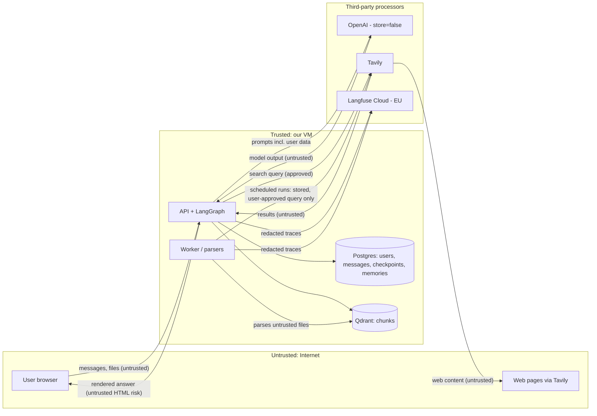
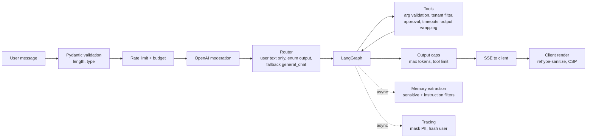

# LLM Threat Model — Nexus AI

**Version:** 1.2 · **Date:** 2026-11-21 (v1.1: router, documents, research, schedules: LLM-T17…T20) · previous 1.1 2026-11-19 (task 003) · **Framework:** OWASP Top 10 for LLM Applications (2025) · **Related:** [AI design](08_ai_system_design.md), [Architecture](03_tech_architecture.md) §8, [Eval plan](09_eval_plan.md) §8

**Working assumption:** every user message, uploaded file, retrieved chunk, web result, stored memory and tool output is attacker-controlled.

## 1. Assets & Trust Boundaries

**Assets:** user conversations and files (PII), generated documents (PDFs), schedules, memories, account credentials/tokens, system prompts, OpenAI/Tavily API keys and budget, Langfuse traces, other users' data.

Key boundary rules: model output is never trusted to choose *whose* data is accessed (tenant id comes from the auth context); content crossing from TB1/TB3 into a prompt is wrapped as data; anything leaving to TB3 is minimised (Tavily receives only the user-approved query). v1.1: the **router sees only user-authored text**; the **PDF renderer has no network or filesystem access** beyond bundled assets; **scheduled runs execute without a human present**, so they may send only what the user approved at creation.

## 2. Threat Table

| ID | OWASP LLM | Threat | Entry point | Impact | Lik. | Mitigation | Test |
|----|-----------|--------|-------------|--------|------|------------|------|
| LLM-T01 | LLM01 Prompt injection (indirect) | Instructions hidden in uploaded docs hijack the agent | `search_my_files` results | Wrong/malicious answers, tool misuse | High | Passages wrapped in `<document>` tags + system rule "data not instructions"; tools with external effect need approval; no tool reads secrets | rt-01, rt-02, rt-03, rt-20 |
| LLM-T02 | LLM01 Prompt injection (indirect) | Web results carry injected instructions / phishing | `web_search` results | Phishing links, memory poisoning | High | `<web_result>` wrapping; **taint rule**: once web or file content entered the turn, `remember_fact` needs user approval (structural, `TOOL_POLICY`); links rendered with `nofollow`, domain shown | rt-04, rt-05 |
| LLM-T03 | LLM01 / LLM07 System prompt leakage | Direct jailbreak or system-prompt extraction | user message | Policy bypass, prompt disclosure | Med | No secrets in prompts (prompt leak is low impact by design); refusal instructions; moderation; canary in system prompt monitored | rt-06, rt-07 |
| LLM-T04 | LLM04 Data & model poisoning | Malicious content stored as long-term memory, affecting all future chats | `extract_memories`, `remember_fact` | Persistent injection | Med | Extraction only from the **user's** message, not tool/doc content; `remember_fact` after untrusted content needs approval (taint rule); instruction-like memories rejected by filter; memories injected as `<user_memory>` data in the late context message; user can view/delete all | rt-05, rt-08, rt-09 |
| LLM-T05 | LLM02 Sensitive info disclosure | Cross-tenant leakage via vector search | Qdrant query | Disclosure of other users' documents | Low (severe) | Mandatory `user_id` filter added in retriever code, not tool args; tenant-indexed payload; integration test per release | rt-10, rt-11, `test_isolation.py` |
| LLM-T06 | LLM02 Sensitive info disclosure | IDOR on conversations/files/memories/checkpoints/documents/schedules | REST API, store namespaces | Disclosure | Low (severe) | Repository methods require `user_id`; 404 on mismatch; store namespace `("memories", user_id)`; thread ids are UUIDs checked against owner | rt-12, API isolation tests |
| LLM-T07 | LLM02 / LLM06 | Exfiltration of private data via tool arguments (e.g., doc contents in a web query) | `web_search` args | Private data sent to third party | Med | Human approval shows the exact query; query length cap 400; Tavily only receives the query | rt-13 |
| LLM-T08 | LLM06 Excessive agency | Tool loops, unapproved side effects | agent loop | Cost, unintended actions | Med | ≤ 6 tool calls/turn; only read-only tools + memory writes; approval policy per tool; no tools with destructive side effects in v1 | rt-14 |
| LLM-T09 | LLM05 Improper output handling | XSS / malicious links / image-beacon exfiltration via markdown | rendered answer | Account takeover, data exfiltration | Med | `react-markdown` + `rehype-sanitize` (no raw HTML), external images blocked by CSP `img-src 'self' data:`, links `noopener noreferrer nofollow` | rt-03, rt-15, e2e DOM check |
| LLM-T10 | LLM02 | PII/secrets in traces, logs, eval data | Langfuse Cloud, logs | Privacy breach (traces are stored by a third party) | Med | `mask` redaction runs before export (mandatory); hashed user ids; EU region; logs exclude content; 30-day trace retention; datasets anonymised | unit test on mask function; log lint |
| LLM-T11 | LLM10 Unbounded consumption | Denial of wallet: long prompts, huge files, many requests | chat, upload | Cost overrun, outage | Med (invite-only) | Invite-only registration; message ≤ 16k chars; max output tokens (incl. reasoning); per-user 30 msg/min + **$0.50/day**; **global $5/day cap**; file 20 MB/500 pages; OpenAI project budget cap; spend alert at 80% of the global cap | rt-19, load test |
| LLM-T12 | LLM03 Supply chain / LLM04 | Malicious files exploit parsers (zip bombs in DOCX, malformed PDFs) | worker | RCE / DoS on worker | Med | Parse in worker only, non-root container, no network egress except OpenAI/Qdrant/Postgres, decompressed-size limits, per-job timeout 5 min, memory limit | fuzz corpus in parser tests |
| LLM-T13 | LLM03 Supply chain | Model/provider behaviour change or dependency compromise | OpenAI model updates (GPT-6 models are alias-only), PyPI/npm | Silent quality/safety regression | Med | Pinned snapshots where available (judge `gpt-5.5-2026-04-23`; `gpt-5.4-mini-2026-03-17` as pinned chat alternative); nightly full evals as the drift alarm for alias-only models; lockfiles, Dependabot, pip-audit/npm audit, Trivy | nightly eval |
| LLM-T14 | LLM09 / content safety | Harmful content generation | user message | Abuse, reputational harm | Low (invite-only) | `omni-moderation-latest` on input (fail-open on outage, logged + tagged); model safety; refusal eval | rt-17, `chat.refusal_accuracy` |
| LLM-T15 | LLM05 / LLM06 | Code execution via calculator | `calculator` args | RCE | Low | AST whitelist evaluator, no `eval`, operand size limits (no `9**9**9`), 1 s timeout | rt-16, fuzz tests |
| LLM-T16 | LLM09 Misinformation | Hallucinated facts presented as grounded | answers | Bad decisions | High | Citations required for file/web facts; "not found" behaviour; faithfulness gate | rt-18, `rag.faithfulness` |
| LLM-T17 | LLM01 / LLM06 | **Router manipulation:** injected text steers a message to a side-effect intent (schedule, memory forget) or away from a guarded path | `route` input | Unwanted schedules or memory changes; skipped guardrails | Med | Router input = the last 3 **user** messages + previous intent only (no tool output, documents or memories); output is an enum + Pydantic-validated slots that never carry ids; the router grants no permissions (`create_schedule` always interrupts, memory `forget` deletes at most one clear match); `ROUTER_DISABLED` kill switch | rt-22, `router.*` |
| LLM-T18 | LLM05 Improper output handling | **PDF renderer abuse:** untrusted thread/web content becomes HTML that makes WeasyPrint fetch `file://` or internal URLs (SSRF, local file read), or embeds `javascript:` links | `render_document` | Local file or cloud-metadata disclosure inside a PDF the user downloads; malicious links | Med | Markdown → HTML with the client's sanitiser allowlist (no raw HTML); deny-all URL fetcher (bundled CSS/fonts only); links only `http(s)`, printed in full; render in the worker (non-root, egress limited as LLM-T12), 60 s timeout, ≤ 30 pages; PDFs served `Content-Disposition: attachment` | rt-23, `documents.external_fetches` |
| LLM-T19 | LLM06 Excessive agency / LLM10 | **Unattended execution via schedules:** a schedule created by injection or by mistake keeps running, spending budget and sending outbound queries with no human present | `schedule_task`, `run_schedule` | Cost, data sent to third parties, persistent unwanted activity | Med | Creation always needs approval showing the exact query and cadence; scheduled runs send only the stored query (news brief) or ≤ 3 queries containing the stored topic (research), with no `general_chat` tools and no memory writes; 5 active per user, cadence ≥ daily; budget pre-check; pause after 3 failures; `SCHEDULES_DISABLED=1` | rt-24, rt-26 |
| LLM-T20 | LLM02 / LLM10 | **Deep-research exfiltration and cost:** the planner puts private context (memories, thread text) into web queries, or plans many expensive searches | `research_plan` | Private data sent to Tavily; cost overrun | Med | Every planned query is shown in one approval before any search; only approved queries run; ≤ 6 queries × 400 chars; per-run $0.05 cap with a pre-run budget check; `INTENTS_DISABLED=deep_research` | rt-25, `research.unapproved_queries` |

## 3. Tool Permission Matrix

| Tool | Auth scope | Approval | Rate limit | Allowed args / destinations |
|------|-----------|----------|-----------|-----------------------------|
| `search_my_files` | caller's `user_id` (from JWT, injected server-side) | no | within 6 calls/turn | `query` ≤ 400 chars, `file_ids` ≤ 10 and must belong to caller (filtered, not trusted) |
| `web_search` | none | **yes, every call** | 6/turn, 100/user/day | `query` ≤ 400 chars → Tavily only; `max_results=5`; no URL fetching in v1 |
| `calculator` | none | no | 6/turn | expression ≤ 200 chars, AST whitelist |
| `remember_fact` | caller's `user_id` | **only if untrusted content entered the turn** (taint rule); otherwise no | 3/turn | content ≤ 500 chars; rejected if memory disabled, sensitive category, or instruction-like ("always", "ignore", "from now on you…") |
| `research_search` (pipeline step) | none | **yes, one approval for the whole plan** | ≤ 6/run; research runs count towards the 100 web searches/user/day | approved queries only, ≤ 400 chars → Tavily |
| `render_document` (job) | caller's `user_id` | no | 10 documents/user/day | sanitised HTML; deny-all URL fetcher; ≤ 30 pages |
| `create_schedule` (pipeline step) | caller's `user_id` | **yes, always** | 5 active/user | cadence daily/weekly; stored query ≤ 400 chars; topic ≤ 200 chars |
| `memory_ops` (`manage_memory`) | caller's `user_id` | no (user-authored input only) | 3 writes/turn | same rules as `remember_fact` |

Kill switches (env, hot-reloaded every 60 s): `TOOLS_DISABLED=web_search,…`, `MEMORY_WRITES_DISABLED=1`, `CHAT_MODEL_OVERRIDE=<model>`, `READ_ONLY_MODE=1` (no new runs, history readable). v1.1: `ROUTER_DISABLED=1` (everything → `general_chat`), `INTENTS_DISABLED=deep_research,generate_document,…`, `SCHEDULES_DISABLED=1` (no new schedules; due runs are skipped, not queued).

## 4. Guardrail Architecture

## 5. Logging & Privacy

- **Traces (Langfuse Cloud, EU region):** prompts/completions included (needed for debugging and evals) after the `mask` function redacts emails, phone numbers, IBAN/card-like numbers, JWTs and API-key patterns — redaction runs before anything leaves the VM; user id hashed (HMAC with server secret); retention 30 days; access limited to the Langfuse org members (the developer). Self-hosters can keep traces on their own infrastructure with the optional Langfuse v4 profile.
- **App logs:** metadata only (route, status, latency, ids); never message content, file names or memory text.
- **Eval datasets:** synthetic or anonymised; never raw production data.
- **User deletion:** `purge_user` deletes Postgres rows, checkpoints (`adelete_thread`), store namespace, Qdrant points by `user_id`, uploaded files; Langfuse traces age out within 30 days (hashed id, no direct identifier).
- **Third parties:** OpenAI API (Responses API with `store=false`; no training on API data by default), Tavily (approved queries only), Langfuse Cloud EU (redacted traces, 30 days). Listed in the README privacy section.

## 6. Incident Response

| Situation | Action | Owner |
|-----------|--------|-------|
| Suspected cross-tenant leak | `READ_ONLY_MODE=1`; preserve logs/traces; run isolation suite; notify affected users within 72 h | on-call engineer |
| Injection campaign via web results | `TOOLS_DISABLED=web_search`; add cases to red-team set; patch prompt; re-enable after eval passes | AI owner |
| Memory poisoning found | `MEMORY_WRITES_DISABLED=1`; script to find and delete matching memories; fix filters | AI owner |
| Cost spike | spend alert → identify user via `usage_daily`; disable user (CLI); lower budget | on-call |
| Runaway or abusive schedules | `SCHEDULES_DISABLED=1`; list schedules by user (CLI); pause/delete; add a red-team case | on-call |
| PDF renderer fetched an external or local resource | `INTENTS_DISABLED=generate_document`; check `render_document` logs; delete affected PDFs; fix the fetcher allowlist | AI owner |
| Model regression after provider update | `CHAT_MODEL_OVERRIDE` to the pinned alternative (`gpt-5.4-mini-2026-03-17`) — alias-only models have no previous snapshot; run full evals | AI owner |

Alerts go to the team channel from Uptime monitoring and the nightly eval workflow; Langfuse cost/feedback dashboards are reviewed weekly.
