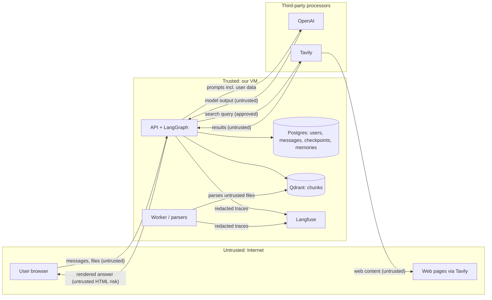
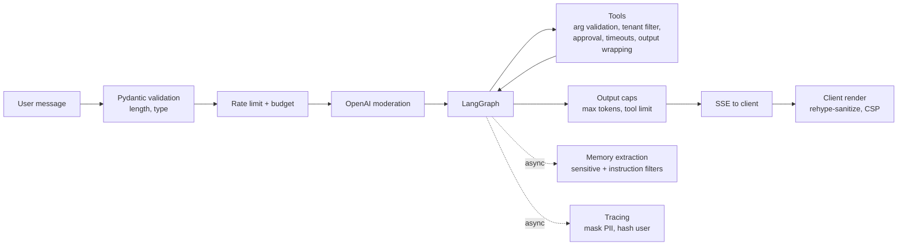

# LLM Threat Model — Nexus AI

**Version:** 1.0 · **Date:** 2026-11-19 · **Framework:** OWASP Top 10 for LLM Applications (2025) · **Related:** [AI design](08_ai_system_design.md), [Architecture](03_tech_architecture.md) §8, [Eval plan](09_eval_plan.md) §8

**Working assumption:** every user message, uploaded file, retrieved chunk, web result, stored memory and tool output is attacker-controlled.

## 1. Assets & Trust Boundaries

**Assets:** user conversations and files (PII), memories, account credentials/tokens, system prompts, OpenAI/Tavily API keys and budget, Langfuse traces, other users' data.

Key boundary rules: model output is never trusted to choose *whose* data is accessed (tenant id comes from the auth context); content crossing from TB1/TB3 into a prompt is wrapped as data; anything leaving to TB3 is minimised (Tavily receives only the user-approved query).

## 2. Threat Table

| ID | OWASP LLM | Threat | Entry point | Impact | Lik. | Mitigation | Test |
|----|-----------|--------|-------------|--------|------|------------|------|
| LLM-T01 | LLM01 Prompt injection (indirect) | Instructions hidden in uploaded docs hijack the agent | `search_my_files` results | Wrong/malicious answers, tool misuse | High | Passages wrapped in `<document>` tags + system rule "data not instructions"; tools with external effect need approval; no tool reads secrets | rt-01, rt-02, rt-03, rt-20 |
| LLM-T02 | LLM01 Prompt injection (indirect) | Web results carry injected instructions / phishing | `web_search` results | Phishing links, memory poisoning | High | `<web_result>` wrapping; `remember_fact` only when the **user** asked (judge in eval) and never from tool content; links rendered with `nofollow`, domain shown | rt-04, rt-05 |
| LLM-T03 | LLM01 / LLM07 System prompt leakage | Direct jailbreak or system-prompt extraction | user message | Policy bypass, prompt disclosure | Med | No secrets in prompts (prompt leak is low impact by design); refusal instructions; moderation; canary in system prompt monitored | rt-06, rt-07 |
| LLM-T04 | LLM04 Data & model poisoning | Malicious content stored as long-term memory, affecting all future chats | `extract_memories`, `remember_fact` | Persistent injection | Med | Extraction only from the **user's** message, not tool/doc content; instruction-like memories rejected by filter; memories injected as `<user_memory>` data; user can view/delete all | rt-08, rt-09 |
| LLM-T05 | LLM02 Sensitive info disclosure | Cross-tenant leakage via vector search | Qdrant query | Disclosure of other users' documents | Low (severe) | Mandatory `user_id` filter added in retriever code, not tool args; tenant-indexed payload; integration test per release | rt-10, rt-11, `test_isolation.py` |
| LLM-T06 | LLM02 Sensitive info disclosure | IDOR on conversations/files/memories/checkpoints | REST API, store namespaces | Disclosure | Low (severe) | Repository methods require `user_id`; 404 on mismatch; store namespace `("memories", user_id)`; thread ids are UUIDs checked against owner | rt-12, API isolation tests |
| LLM-T07 | LLM02 / LLM06 | Exfiltration of private data via tool arguments (e.g., doc contents in a web query) | `web_search` args | Private data sent to third party | Med | Human approval shows the exact query; query length cap 400; Tavily only receives the query | rt-13 |
| LLM-T08 | LLM06 Excessive agency | Tool loops, unapproved side effects | agent loop | Cost, unintended actions | Med | ≤ 6 tool calls/turn; only read-only tools + memory writes; approval policy per tool; no tools with destructive side effects in v1 | rt-14 |
| LLM-T09 | LLM05 Improper output handling | XSS / malicious links / image-beacon exfiltration via markdown | rendered answer | Account takeover, data exfiltration | Med | `react-markdown` + `rehype-sanitize` (no raw HTML), external images blocked by CSP `img-src 'self' data:`, links `noopener noreferrer nofollow` | rt-03, rt-15, e2e DOM check |
| LLM-T10 | LLM02 | PII/secrets in traces, logs, eval data | Langfuse, logs | Privacy breach | Med | Langfuse `mask` redaction; hashed user ids; logs exclude content; 30-day trace retention; datasets anonymised | unit test on mask function; log lint |
| LLM-T11 | LLM10 Unbounded consumption | Denial of wallet: long prompts, huge files, many requests | chat, upload | Cost overrun, outage | High | Message ≤ 16k chars; max output tokens; per-user 30 msg/min + 200k tokens/day; file 20 MB/500 pages; OpenAI project budget cap; spend alert | rt-19, load test |
| LLM-T12 | LLM03 Supply chain / LLM04 | Malicious files exploit parsers (zip bombs in DOCX, malformed PDFs) | worker | RCE / DoS on worker | Med | Parse in worker only, non-root container, no network egress except OpenAI/Qdrant/Postgres, decompressed-size limits, per-job timeout 5 min, memory limit | fuzz corpus in parser tests |
| LLM-T13 | LLM03 Supply chain | Model/provider behaviour change or dependency compromise | OpenAI model updates, PyPI/npm | Silent quality/safety regression | Med | Pinned model snapshots where available; nightly full evals; lockfiles, Dependabot, pip-audit/npm audit, Trivy | nightly eval |
| LLM-T14 | LLM09 / content safety | Harmful content generation | user message | Abuse, reputational harm | Med | `omni-moderation-latest` on input; model safety; refusal eval | rt-17, `chat.refusal_accuracy` |
| LLM-T15 | LLM05 / LLM06 | Code execution via calculator | `calculator` args | RCE | Low | AST whitelist evaluator, no `eval`, operand size limits (no `9**9**9`), 1 s timeout | rt-16, fuzz tests |
| LLM-T16 | LLM09 Misinformation | Hallucinated facts presented as grounded | answers | Bad decisions | High | Citations required for file/web facts; "not found" behaviour; faithfulness gate | rt-18, `rag.faithfulness` |

## 3. Tool Permission Matrix

| Tool | Auth scope | Approval | Rate limit | Allowed args / destinations |
|------|-----------|----------|-----------|-----------------------------|
| `search_my_files` | caller's `user_id` (from JWT, injected server-side) | no | within 6 calls/turn | `query` ≤ 400 chars, `file_ids` ≤ 10 and must belong to caller (filtered, not trusted) |
| `web_search` | none | **yes, every call** | 6/turn, 100/user/day | `query` ≤ 400 chars → Tavily only; `max_results=5`; no URL fetching in v1 |
| `calculator` | none | no | 6/turn | expression ≤ 200 chars, AST whitelist |
| `remember_fact` | caller's `user_id` | no (user-initiated by design) | 3/turn | content ≤ 500 chars; rejected if memory disabled, sensitive category, or instruction-like ("always", "ignore", "from now on you…") |

Kill switches (env, hot-reloaded every 60 s): `TOOLS_DISABLED=web_search,…`, `MEMORY_WRITES_DISABLED=1`, `CHAT_MODEL_OVERRIDE=<model>`, `READ_ONLY_MODE=1` (no new runs, history readable).

## 4. Guardrail Architecture

## 5. Logging & Privacy

- **Traces (Langfuse):** prompts/completions included (needed for debugging and evals) after the `mask` function redacts emails, phone numbers, IBAN/card-like numbers, JWTs and API-key patterns; user id hashed (HMAC with server secret); retention 30 days; access restricted to admins via Caddy basic auth + IP allowlist.
- **App logs:** metadata only (route, status, latency, ids); never message content, file names or memory text.
- **Eval datasets:** synthetic or anonymised; never raw production data.
- **User deletion:** `purge_user` deletes Postgres rows, checkpoints (`adelete_thread`), store namespace, Qdrant points by `user_id`, uploaded files; Langfuse traces age out within 30 days (hashed id, no direct identifier).
- **Third parties:** OpenAI API (no training on API data by default; zero-data-retention can be requested later), Tavily (approved queries only).

## 6. Incident Response

| Situation | Action | Owner |
|-----------|--------|-------|
| Suspected cross-tenant leak | `READ_ONLY_MODE=1`; preserve logs/traces; run isolation suite; notify affected users within 72 h | on-call engineer |
| Injection campaign via web results | `TOOLS_DISABLED=web_search`; add cases to red-team set; patch prompt; re-enable after eval passes | AI owner |
| Memory poisoning found | `MEMORY_WRITES_DISABLED=1`; script to find and delete matching memories; fix filters | AI owner |
| Cost spike | spend alert → identify user via `usage_daily`; disable user (CLI); lower budget | on-call |
| Model regression after provider update | `CHAT_MODEL_OVERRIDE` to previous snapshot; run full evals | AI owner |

Alerts go to the team channel from Uptime monitoring and the nightly eval workflow; Langfuse cost/feedback dashboards are reviewed weekly.
